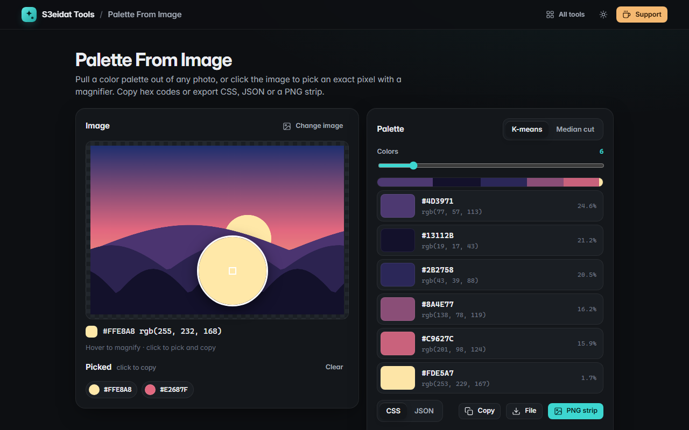

# Palette From Image

> Extract a color palette from any photo and pick exact pixels. Free, private, and it runs entirely in your browser.

### ▶ [Open Palette From Image](https://s3eidat.github.io/palette-from-image/)



## Features

- **5 to 12 colors**, biggest share first, with the percentage each one covers
- Two methods: **k-means** (balanced, natural) and **median cut** (classic, fast)
- **Pixel picker with a magnifier**: hover to zoom in, click to pick the exact pixel and copy its hex
- Click any swatch to **copy the hex**; rgb values shown too
- **Export** as CSS custom properties or JSON (copy or download), or a **PNG swatch strip**
- Transparent pixels are ignored; huge photos are analysed on a downsampled copy so it stays fast

## Privacy


Your images never leave your device. There is no server, no account, no analytics.
The page ships with a strict Content-Security-Policy (`connect-src 'self'`), so the browser
itself blocks any attempt to send data anywhere.

## Run it yourself

It's plain HTML, CSS and JavaScript with no build step:

```bash
git clone https://github.com/s3eidat/palette-from-image
cd palette-from-image
python -m http.server 8000
```

Then open http://localhost:8000.

## Support

If this saved you time, **[buy me a coffee ☕](https://s3eidat.github.io/coffee/)**. It keeps every tool free.

---

Part of **[S3eidat Tools](https://s3eidat.github.io/)**: 100+ free, private tools that run in your browser. MIT licensed.
